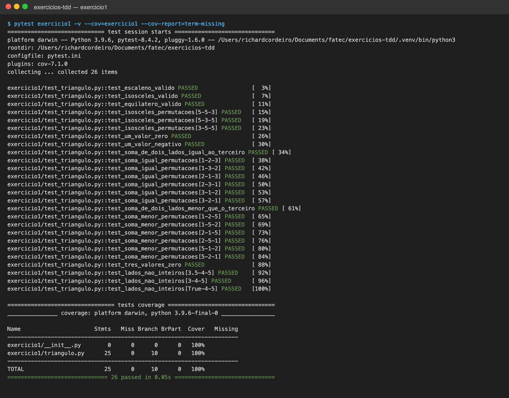
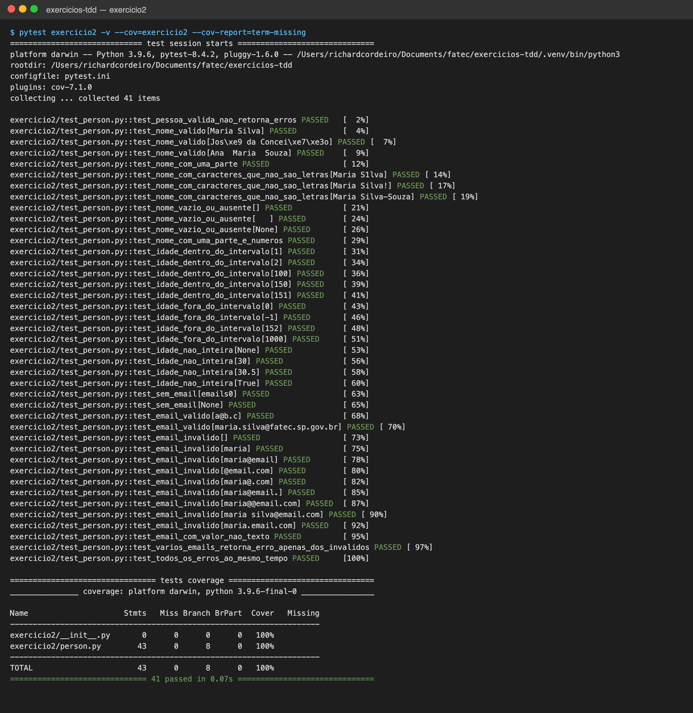
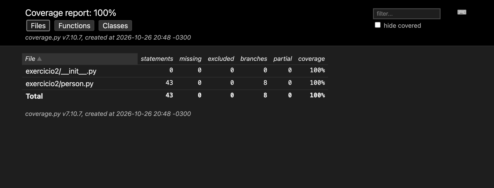
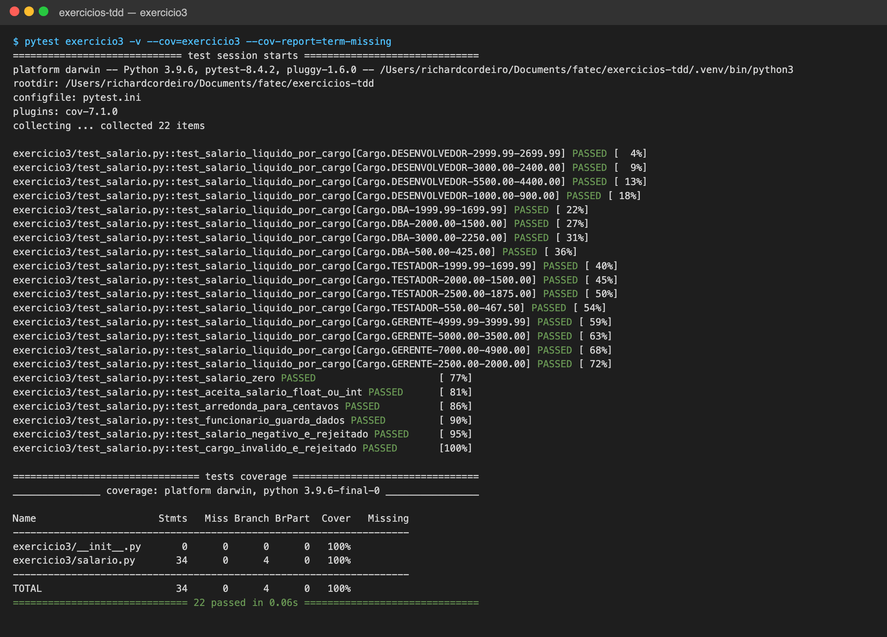

# Exercícios de Teste Unitário e TDD — Python + pytest

Resolução dos três exercícios (Triângulo, validação de `Person` e calculadora de salário) em **Python 3.9+** com **pytest** e **pytest-cov** para a cobertura de código.

## Estrutura

```
exercicios-tdd/
├── exercicio1/             # Triângulo
│   ├── triangulo.py
│   └── test_triangulo.py
├── exercicio2/             # Person / Email / PersonDAO.isValidToInclude()
│   ├── person.py
│   └── test_person.py
├── exercicio3/             # Calculadora de salário
│   ├── salario.py
│   └── test_salario.py
├── docs/evidencias/      # prints de execução e cobertura de cada exercício
├── .coveragerc             # cobertura de branches, sem contar os arquivos de teste
├── pytest.ini
└── requirements.txt
```

## Build

O projeto não tem etapa de compilação; o "build" é criar o ambiente virtual e instalar as dependências:

```bash
python3 -m venv .venv
source .venv/bin/activate        # Windows: .venv\Scripts\activate
pip install -r requirements.txt
```

## Execução dos testes

Todos os testes:

```bash
pytest
```

Todos os testes com cobertura (linhas + branches):

```bash
pytest --cov=exercicio1 --cov=exercicio2 --cov=exercicio3 --cov-report=term-missing
```

Um exercício por vez, por exemplo o 1:

```bash
pytest exercicio1 --cov=exercicio1 --cov-report=term-missing
```

Relatório HTML (abre `htmlcov/index.html` no navegador):

```bash
pytest --cov=exercicio1 --cov=exercicio2 --cov=exercicio3 --cov-report=html
```

---

## Exercício 1 — Triângulo

### Esqueleto da classe

```python
class TipoTriangulo(Enum):
    EQUILATERO, ISOSCELES, ESCALENO

class TrianguloInvalidoError(ValueError): ...

class Triangulo:
    def __init__(self, a: int, b: int, c: int)   # valida e lança TrianguloInvalidoError
    def classificar(self) -> TipoTriangulo
```

Regras de validação: os lados devem ser inteiros, maiores que zero e a soma de quaisquer dois lados deve ser **maior** que o terceiro.

### Casos de teste

| Item | Situação | Entrada(s) | Esperado |
|---|---|---|---|
| 2.1 | Escaleno válido | (3, 4, 5) | ESCALENO |
| 2.2 | Isósceles válido | (5, 5, 3) | ISOSCELES |
| 2.3 | Equilátero válido | (4, 4, 4) | EQUILATERO |
| 2.4 | Isósceles — permutações | (5,5,3), (5,3,5), (3,5,5) | ISOSCELES |
| 2.5 | Um valor zero | (0, 4, 5) | erro |
| 2.6 | Um valor negativo | (-3, 4, 5) | erro |
| 2.7 | Soma de 2 lados = terceiro | (1, 2, 3) | erro |
| 2.8 | Permutações do item 2.7 | (1,2,3), (1,3,2), (2,1,3), (2,3,1), (3,1,2), (3,2,1) | erro |
| 2.9 | Soma de 2 lados < terceiro | (1, 2, 5) | erro |
| 2.10 | Permutações do item 2.9 | (1,2,5), (1,5,2), (2,1,5), (2,5,1), (5,1,2), (5,2,1) | erro |
| 2.11 | Três valores zero | (0, 0, 0) | erro |
| extra | Lados não inteiros | (3.5,4,5), ("3",4,5), (True,4,5) | erro |

### Evidência de cobertura

Execução dos testes com cobertura no terminal:



Relatório HTML de cobertura (pytest-cov):


Saída em texto:

```
$ pytest exercicio1 --cov=exercicio1 --cov-report=term-missing
exercicio1/test_triangulo.py ..........................                  [100%]
Name                      Stmts   Miss Branch BrPart  Cover   Missing
---------------------------------------------------------------------
exercicio1/__init__.py        0      0      0      0   100%
exercicio1/triangulo.py      25      0     10      0   100%
---------------------------------------------------------------------
TOTAL                        25      0     10      0   100%
============================== 26 passed in 0.04s ==============================
```

---

## Exercício 2 — `PersonDAO.isValidToInclude()` (TDD)

Classes:

```python
@dataclass
class Email:
    name: str

@dataclass
class Person:
    name: str
    age: int
    emails: List[Email]

class PersonDAO:
    def isValidToInclude(self, person: Person) -> List[str]   # lista vazia = válido
```

Regras validadas (cada uma gera uma mensagem de erro própria, e todas são acumuladas na lista):

- o nome tem ao menos 2 partes separadas por espaço e cada parte contém apenas letras (acentos permitidos);
- a idade é um inteiro no intervalo `[1, 151]`;
- a pessoa tem ao menos um `Email`;
- cada `Email.name` segue o formato `_____@____._____`, com ao menos um caractere em cada parte (regex `^[^@\s]+@[^@\s.]+\.[^@\s]+$`).

### Ciclos de TDD

1. **Vermelho:** `test_pessoa_valida_nao_retorna_erros` → **Verde:** `isValidToInclude` retornando `[]`.
2. **Vermelho:** nome com uma parte → **Verde:** checagem de `len(name.split()) < 2`.
3. **Vermelho:** nome com dígitos/símbolos → **Verde:** `isalpha()` em cada parte.
4. **Vermelho:** idades 0, -1, 152 e fronteiras 1 e 151 → **Verde:** checagem de intervalo; depois tipos não inteiros.
5. **Vermelho:** pessoa sem e-mail → **Verde:** checagem de lista vazia/`None`.
6. **Vermelho:** formatos de e-mail inválidos → **Verde:** regex.
7. **Refatoração:** cada regra extraída para um método `_validar_*` e mensagens em constantes, mantendo os testes verdes; teste final com todos os erros simultâneos.

### Evidência de cobertura

Execução dos testes com cobertura no terminal:



Relatório HTML de cobertura (pytest-cov):



Saída em texto:

```
$ pytest exercicio2 --cov=exercicio2 --cov-report=term-missing
exercicio2/test_person.py .........................................      [100%]
Name                     Stmts   Miss Branch BrPart  Cover   Missing
--------------------------------------------------------------------
exercicio2/__init__.py       0      0      0      0   100%
exercicio2/person.py        43      0      8      0   100%
--------------------------------------------------------------------
TOTAL                       43      0      8      0   100%
============================== 41 passed in 0.05s ==============================
```

---

## Exercício 3 — Calculadora de salário (TDD)

Classes:

- `Cargo` (enum): `DESENVOLVEDOR`, `DBA`, `TESTADOR`, `GERENTE`;
- `Funcionario`: `nome`, `email`, `salario_base` (`Decimal`) e `cargo`;
- `RegraDesconto`: limite, desconto quando `salário >= limite` e desconto abaixo do limite;
- `CalculadoraSalario.calcular_salario_liquido(funcionario) -> Decimal` (arredondado em centavos).

| Cargo | Limite | Desconto se ≥ limite | Desconto se < limite |
|---|---|---|---|
| DESENVOLVEDOR | 3.000,00 | 20% | 10% |
| DBA | 2.000,00 | 25% | 15% |
| TESTADOR | 2.000,00 | 25% | 15% |
| GERENTE | 5.000,00 | 30% | 20% |

### Ciclos de TDD

1. **Vermelho:** desenvolvedor com 5.500,00 → 4.400,00 → **Verde:** desconto fixo de 20%.
2. **Vermelho:** desenvolvedor com 1.000,00 → 900,00 → **Verde:** `if` pelo limite de 3.000,00.
3. **Vermelho:** casos de fronteira (2.999,99 e 3.000,00) → **Verde:** comparação `>=` e uso de `Decimal` para evitar erro de ponto flutuante.
4. **Vermelho:** DBA, TESTADOR e GERENTE → **Verde:** um `if` por cargo.
5. **Refatoração:** os `if`s viraram a tabela `REGRAS` de `RegraDesconto` por cargo, com os testes verdes.
6. Testes adicionais: salário zero, arredondamento, salário negativo e cargo inválido rejeitados.

Para cada cargo há um caso abaixo do limite, um exatamente no limite e um acima.

### Evidência de cobertura

Execução dos testes com cobertura no terminal:



Relatório HTML de cobertura (pytest-cov):


Saída em texto:

```
$ pytest exercicio3 --cov=exercicio3 --cov-report=term-missing
exercicio3/test_salario.py ......................                        [100%]
Name                     Stmts   Miss Branch BrPart  Cover   Missing
--------------------------------------------------------------------
exercicio3/__init__.py       0      0      0      0   100%
exercicio3/salario.py        34      0      4      0   100%
--------------------------------------------------------------------
TOTAL                        34      0      4      0   100%
============================== 22 passed in 0.04s ==============================
```

## Resumo

| Exercício | Testes | Cobertura (linhas + branches) |
|---|---|---|
| 1 — Triângulo | 26 | 100% |
| 2 — Person | 41 | 100% |
| 3 — Salário | 22 | 100% |
